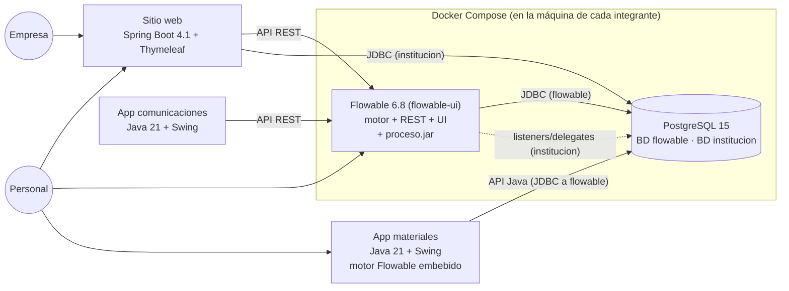

# 02 · Arquitectura y tecnologías

## 1. Vista general



| Componente | Módulo | Qué hace | Cómo habla con Flowable (exigido por) |
|------------|--------|----------|---------------------------------------|
| Proceso | `proceso/` | Modelo BPMN, regla DMN, listeners y delegates Java. El jar se monta en el classpath del servidor. | Corre **dentro** del motor (§3) |
| Servidor Flowable | `docker-compose.yml` | Motor, REST y UI (Task, Modeler, IDM, Admin). | — |
| Sitio web | `web/` | Sección pública, portal de empresas, administración y docentes; PDFs de propuestas. | **API REST** (§4.1) |
| App materiales | `app-materiales/` | Login + tareas *Preparar materiales*: ver, reclamar, completar. | **API Java** sobre la BD del motor (§4.2.1) |
| App comunicaciones | `app-comunicaciones/` | Simula los mensajes de la empresa; solo muestra los habilitados. | **API REST** (§4.2.2) |
| PostgreSQL | `docker-compose.yml`, `db/` | BD `flowable` (motor) y BD `institucion` (empresas, cursos, propuestas). | — |
| Consultas históricas (parte de la app de materiales) | `app-materiales/`, paquete `historial` | Las tres consultas del §4.3: resultados de las solicitudes, duración de las ramas de la preparación y tareas completadas por persona. | **API Java** (`HistoryService`) sobre la BD del motor |
| Minería de procesos | `mineria/` | Scripts Python de la cátedra adaptados: exportar a CSV el historial de la etapa de negociación y analizarlo con PM4Py (§4.4). | Lee el historial de Flowable (el script de la cátedra usa `requests`, es decir, la API REST) |

## 2. Tecnologías y por qué

El enunciado no fija tecnologías para el sitio ni para las apps (ver 01-requerimientos §1). El criterio fue: lo más
moderno que sea **compatible con Flowable 6.8** y que mantenga el código simple. Todo en **Java**, para que el grupo
use un solo lenguaje y porque la app de materiales igual tiene que ser Java. La única excepción es la minería de
procesos (§4.4), que usa los scripts Python que provee la cátedra.

| Pieza | Elección | Motivo |
|-------|----------|--------|
| Motor | Flowable **6.8.0** (imagen oficial) | Lo usa la cátedra y trae la UI de Flowable que pide §4.1.3. La app de materiales usa la misma versión del motor, porque trabaja sobre la misma BD. |
| Extensiones del motor | Java, `--release 11` | La imagen corre Java 11.0.15, así que el jar tiene que estar compilado para esa versión. |
| JDK de desarrollo | **Java 21 LTS** (Temurin) | Versión LTS, con records, `switch` con patrones y text blocks. Compila también el módulo `proceso` para Java 11. |
| Build | Maven multi-módulo + **Maven Wrapper** | Es lo que se usa en las prácticas; el wrapper fija Maven 3.9.16 para todo el grupo. |
| Web | **Spring Boot 4.1** + **Thymeleaf** (HTML renderizado en el servidor) | Un solo proyecto para pantallas y lógica: formularios, sesión y seguridad resueltos por el framework. |
| Acceso a BD (web) | `JdbcClient` + SQL | Son 4 tablas: SQL explícito y legible. |
| Esquema de la institución | **Flyway** (`web/src/main/resources/db/migration`) | Cada integrante actualiza su BD solo con hacer pull y levantar la web, y todos quedan con el mismo esquema. |
| Cliente REST (web) | `RestClient` de Spring | Viene con Spring Boot. |
| Seguridad (web) | Spring Security con dos formas de entrar: personal contra Flowable y empresas contra la BD (BCrypt) | Cumple A-08 y W-03 con un mecanismo probado. |
| PDF | OpenPDF | Simple, con licencia LGPL/MPL. |
| Apps de escritorio | **Swing** (JDK) + **FlatLaf** | Swing viene con el JDK y alcanza para listas, formularios y botones; FlatLaf le da un aspecto moderno con una sola dependencia. |
| HTTP (app comunicaciones) | `java.net.http.HttpClient` + Jackson | El cliente HTTP del JDK alcanza; Jackson para JSON. |
| BD | **PostgreSQL 15** en Docker | La recomienda el anexo B de la práctica 4. La comparten el servidor y la app de materiales, y los datos persisten en un volumen. |
| Tests del proceso | JUnit 5 + `@FlowableTest` + H2 en memoria | Corren sin Docker y en CI (práctica 5). |
| Hash de claves de las empresas | BCrypt (`spring-security-crypto`, ya incluido en la imagen de Flowable) | Es el formato que espera `cuenta_empresa.password_hash`; no hace falta agregar otra dependencia al servidor. |
| CI | GitHub Actions: `./mvnw verify` en cada push | Avisa enseguida si algo rompe el build o los tests. |
| Consultas históricas (§4.3) | En la **app de materiales**, con `HistoryService` | El §4.3 lo permite, y esa app ya tiene el motor embebido y acceso a la BD del motor. |
| Minería de procesos (§4.4) | **Python + PM4Py + pandas**, en `mineria/` con su propio entorno virtual | Son los scripts y la herramienta que provee el enunciado. |

## 3. Trabajo en grupo y datos compartidos

- **Cada integrante levanta su propio entorno** con `docker compose up -d`. Los datos (instancias, tareas,
  solicitudes) son locales a cada máquina.
- **Lo que se comparte es la definición del sistema, en git:** el modelo BPMN y la regla DMN, las migraciones de la
  BD, los scripts de usuarios y despliegue, y el código. Con eso cualquiera reconstruye un entorno idéntico en minutos.
- **Cada integrante usa su propio motor y su propia BD:** así los timers y jobs de cada uno se ejecutan solo en su
  máquina, con su versión del código. Para la defensa se usa **una sola máquina**.
- **Datos de prueba:** se generan usando el sistema (formulario web + app de comunicaciones). Para dejar listo cada
  escenario de la defensa están los scripts de `scripts/escenarios/` (docs/12), y `mineria/generar_ejecuciones.py`
  recorre el proceso para tener historial que analizar. Si hacen falta datos fijos, se agrega una migración
  `V…__datos_prueba.sql`.

## 4. Criterios transversales

- **Vínculo curso ↔ instancia:** `curso.process_instance_id` en la BD y `businessKey = curso.id` en Flowable.
- **Autenticación del personal:** la web valida usuario y contraseña con una llamada REST hecha con esas mismas
  credenciales (401 = incorrectas) y después opera en nombre del usuario. La app de materiales usa
  `identityService.checkPassword`. Verificado.
- **Autorización:** Flowable **no impide** que un usuario complete la tarea de otro (verificado). Las reglas de A-06
  ("las asignadas solo las completa su usuario", "las de grupo se reclaman antes") se validan en la web y en la app de
  materiales antes de llamar al motor.
- **Estado del curso para la empresa (W-04/W-05):** se deriva de las actividades en curso de la instancia
  (`/history/historic-activity-instances?finished=false`); el resultado final sale de `curso.estado`.
- **Extensiones del motor que escriben en la BD de la institución:** usan JDBC con `INSTITUCION_DB_*` (ya definidas
  en `docker-compose.yml`). Cada clase recibe sus dependencias por constructor, con un constructor sin argumentos que
  arma las reales (Flowable instancia `flowable:class` con ese). Así en los tests se pasan dobles.
- **Reserva y liberación de recursos (I-10):** `ReservarAulaDelegate` y `LiberarAulaDelegate` hablan con
  `ServicioAulas`, cuya implementación por defecto es `ServicioAulasSimulado` (maneja un conjunto fijo de aulas,
  "Aula 101", "Aula 102", …, 10 por defecto o las de `AULAS_DISPONIBLES`; sin aulas libres lanza `AulaNoDisponible`,
  y deja las llamadas en el log). El aula queda en la variable `aulaAsignada`, que la compensación lee para liberarla.
  La virtual usa `ServicioAulasVirtuales`. Cambiar la simulación por un web service real no toca el modelo ni los
  delegates.

## 5. Organización del código

Paquetes por **funcionalidad**, no por capa técnica. Los paquetes Java cuelgan de `ar/edu/unrc/gtpn/` en cada módulo.

```
.
├── proceso/
│   └── src/
│       ├── main/
│       │   ├── java/…/proceso/
│       │   │   ├── viabilidad/       ContarCursosEnEjecucionListener
│       │   │   ├── notificacion/     NotificarEmpresaDelegate
│       │   │   ├── acceso/           HabilitarAccesoEmpresaDelegate, CuentasDeEmpresa(Jdbc), CursoRepository(Jdbc), ConexionInstitucion
│       │   │   ├── recursos/         Reservar/LiberarAula…Delegate, ServicioAulas(Simulado), ServicioAulasVirtuales
│       │   │   ├── asignacion/       AsignarAdministrativoConMenosTareasListener
│       │   │   └── estado/           RegistrarResultadoDelCursoListener
│       │   └── resources/procesos/   organizarCurso.bpmn20.xml, viabilidad.dmn
│       └── test/java/…/proceso/      tests del proceso (negociación, cancelación y compensaciones) y de cada clase
├── web/
│   └── src/main/
│       ├── java/…/web/
│       │   ├── solicitudes/          formulario público (controller, servicio, repositorio)
│       │   ├── empresa/              portal de empresas
│       │   ├── tareas/               bandeja de Administración y Docentes y una pantalla por cada tarea que carga datos
│       │   ├── propuestas/           versiones de la propuesta y su PDF
│       │   ├── flowable/             cliente REST de Flowable (único lugar que conoce URLs y JSON de Flowable)
│       │   └── seguridad/            Spring Security: ingreso del personal y de las empresas
│       └── resources/
│           ├── templates/<funcionalidad>/   páginas Thymeleaf
│           └── db/migration/                migraciones Flyway de la BD de la institución
├── app-materiales/
│   └── src/main/java/…/materiales/
│       ├── MaterialesApp, MotorFlowable, ServicioDeTareas, VentanaDeTareas
│       └── historial/                consultas del §4.3 (ConsultasHistoricas)
├── app-comunicaciones/
│   └── src/main/java/…/comunicaciones/
│       └── ComunicacionesApp, FlowableRest, ComunicacionesDeLaEmpresa, enum Comunicacion (mensaje + datos), VentanaDeSolicitudes
├── mineria/                          exportar_history.py y analizar.py adaptados, CSV, capturas y conclusión (§4.4)
└── scripts/                          usuarios y despliegue (setup-identidades.sh, desplegar-proceso.sh) y escenarios/ de la defensa
```

## 6. Puertos

| Puerto | Servicio |
|--------|----------|
| 5432 | PostgreSQL (`flowable`, `institucion`) |
| 8080 | Flowable: UI en `/flowable-ui`, REST en `/flowable-ui/process-api` |
| 8081 | Sitio web |
| 5050 | pgAdmin (opcional, perfil `herramientas`) |

Los de PostgreSQL y Flowable se cambian en `.env` (ver `.env.example`); el de la web, con `SERVER_PORT`. Docker
publica los puertos solo en `127.0.0.1`.

### Apps de escritorio con Windows y WSL

Si el proyecto se usa en Windows con Docker en WSL, las apps de escritorio (materiales y comunicaciones) se ven mejor
lanzadas **desde Windows** (PowerShell, por ejemplo `.\mvnw.cmd -pl app-comunicaciones compile exec:java`) que desde WSL.
Lanzadas desde WSL, Java usa las ventanas de Linux (WSLg): la barra de título es la de Linux, las fuentes cambian y los
diálogos a veces se abren en la esquina de la pantalla. Desde Windows usa las ventanas nativas y los diálogos se abren
centrados. El funcionamiento es el mismo: las dos apps llegan a Flowable (8080) y a PostgreSQL (5432) por `localhost` desde
cualquiera de los dos lados. Quien use Linux nativo o macOS las verá con el aspecto de su sistema.

