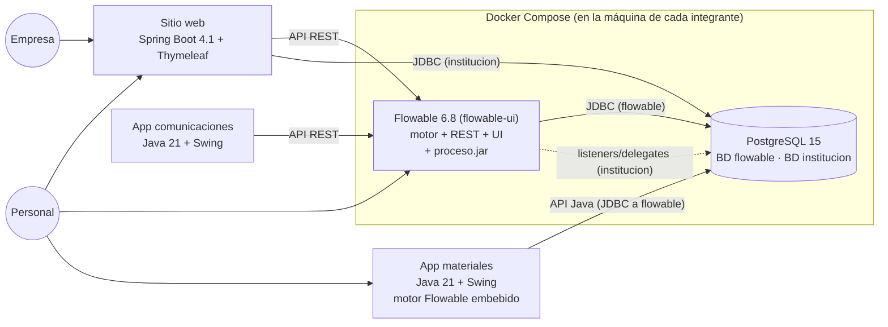

# 02 · Arquitectura y tecnologías

## 1. Vista general



| Componente | Módulo | Qué hace | Cómo habla con Flowable (exigido por) |
|------------|--------|----------|---------------------------------------|
| Proceso | `proceso/` | Modelo BPMN, regla DMN, listeners y delegates Java. El jar se monta en el classpath del servidor. | Corre **dentro** del motor (§3) |
| Servidor Flowable | `docker-compose.yml` | Motor, REST y UI (Task, Modeler, IDM, Admin). | — |
| Sitio web | `web/` | Sección pública, portal de empresas, administración y docentes; PDFs de propuestas. | **API REST** (§4.1) |
| App materiales | `app-materiales/` | Login + tareas *Preparar materiales*: ver, reclamar, completar. | **API Java** sobre la BD del motor (§4.2.1) |
| App comunicaciones | `app-comunicaciones/` | Simula los mensajes de la empresa; solo muestra los habilitados. | **API REST** (§4.2.2) |
| PostgreSQL | `docker-compose.yml`, `db/` | BD `flowable` (motor) y BD `institucion` (empresas, cursos, propuestas). | — |

## 2. Tecnologías y por qué

El enunciado no fija tecnologías para el sitio ni para las apps (ver 01-requerimientos §1). El criterio fue: lo más
moderno que sea **compatible con Flowable 6.8** y que mantenga el código simple. Todo en **Java**, para que el grupo
use un solo lenguaje y porque la app de materiales igual tiene que ser Java.

| Pieza | Elección | Motivo | Descartado |
|-------|----------|--------|------------|
| Motor | Flowable **6.8.0** (imagen oficial) | Lo usa la cátedra; trae la UI de Flowable que pide §4.1.3. La app de materiales tiene que usar la misma versión del motor, porque trabaja sobre la misma BD. | Flowable 7/8: no tienen las apps de UI open source. Embeber 6.8 en Spring Boot 4: incompatible (6.8 usa Spring 5/`javax`; Boot 4 usa Spring 7/`jakarta`). |
| Extensiones del motor | Java, `--release 11` | La imagen corre Java 11.0.15: un jar compilado para 17+ no carga. | — |
| JDK de desarrollo | **Java 21 LTS** (Temurin) | LTS, records, `switch` con patrones, text blocks. Compila también el módulo `proceso` para Java 11. | — |
| Build | Maven multi-módulo + **Maven Wrapper** | Es lo que se usa en las prácticas; el wrapper fija Maven 3.9.16 para los cuatro. | Gradle: otra herramienta más para aprender. |
| Web | **Spring Boot 4.1** + **Thymeleaf** (HTML renderizado en el servidor) | Un solo proyecto, sin build de frontend ni CORS ni tokens. Formularios y sesión resueltos. | SPA (React/Vite) + API: duplica el stack y la autenticación para un sitio de formularios. |
| Acceso a BD (web) | `JdbcClient` + SQL | 4 tablas: SQL explícito y legible. | JPA/Hibernate: demasiado mecanismo para este tamaño. |
| Esquema de la institución | **Flyway** (`web/src/main/resources/db/migration`) | Cada integrante actualiza su BD solo con hacer pull y levantar la web. | Scripts SQL a mano: se desincronizan entre las cuatro máquinas. |
| Cliente REST (web) | `RestClient` de Spring | Viene con Spring Boot. | Feign, WebClient: no hacen falta. |
| Seguridad (web) | Spring Security con dos formas de entrar: personal contra Flowable y empresas contra la BD (BCrypt) | Cumple A-08 y W-03. | Sesiones hechas a mano: riesgoso. |
| PDF | OpenPDF (se agrega al implementar W-07) | Simple, licencia LGPL/MPL. | iText 7+: AGPL. |
| Apps de escritorio | **Swing** (JDK) | Sin dependencias; alcanza para listas, formularios y botones. Opcional: FlatLaf para un aspecto moderno (una sola dependencia). | JavaFX: módulos y plugin extra. |
| HTTP (app comunicaciones) | `java.net.http.HttpClient` + Jackson | El JDK alcanza; Jackson para JSON. | — |
| BD | **PostgreSQL 15** en Docker | La recomienda el anexo B de la práctica 4; la comparten el servidor y la app de materiales. | H2 (ver abajo). |
| Tests del proceso | JUnit 5 + `@FlowableTest` + H2 en memoria | Corren sin Docker y en CI (práctica 5). | — |
| CI | GitHub Actions: `./mvnw verify` en cada push | Avisa enseguida si algo rompe el build o los tests. | — |

## 3. Trabajo en grupo y datos compartidos

- **Cada integrante levanta su propio entorno** con `docker compose up -d`. Los datos (instancias, tareas,
  solicitudes) son locales a cada máquina.
- **Lo que se comparte es la definición del sistema, en git:** el modelo BPMN y la regla DMN, las migraciones de la
  BD, los scripts de usuarios y despliegue, y el código. Con eso cualquiera reconstruye un entorno idéntico en minutos.
- **No conviene compartir una BD del motor en la nube.** Cada motor conectado ejecutaría los timers y jobs de todos,
  con versiones distintas del jar: timers que se disparan en la máquina de otro, errores de clases que no existen.
  Para la defensa se usa **una sola máquina**.
- **Datos de prueba:** se generan usando el sistema (formulario web + app de comunicaciones). Si hacen falta fijos,
  se agrega una migración `V…__datos_prueba.sql`.

## 4. Criterios transversales

- **Vínculo curso ↔ instancia:** `curso.process_instance_id` en la BD y `businessKey = curso.id` en Flowable.
- **Autenticación del personal:** la web valida usuario y contraseña con una llamada REST hecha con esas mismas
  credenciales (401 = incorrectas) y después opera en nombre del usuario. La app de materiales usa
  `identityService.checkPassword`. Verificado.
- **Autorización:** Flowable **no impide** que un usuario complete la tarea de otro (verificado). Las reglas de A-06
  ("las asignadas solo las completa su usuario", "las de grupo se reclaman antes") se validan en la web y en la app de
  materiales antes de llamar al motor.
- **Estado del curso para la empresa (W-04/W-05):** se deriva de las actividades en curso de la instancia
  (`/history/historic-activity-instances?finished=false`); el resultado final sale de `curso.estado`.
- **Extensiones del motor que escriben en la BD de la institución:** usan JDBC con `INSTITUCION_DB_*` (ya definidas
  en `docker-compose.yml`). Cada clase recibe sus dependencias por constructor, con un constructor sin argumentos que
  arma las reales (Flowable instancia `flowable:class` con ese). Así en los tests se pasan dobles.

## 5. Organización del código (propuesta)

Paquetes por **funcionalidad**, no por capa técnica:

```
proceso/src/main/java/ar/edu/unrc/gtpn/proceso/
  viabilidad/      ContarCursosEnEjecucionListener
  notificacion/    NotificarEmpresaDelegate
  acceso/          HabilitarAccesoEmpresaDelegate
  recursos/        ReservarAulaDelegate, LiberarAulaDelegate, ...
  asignacion/      AsignarAdministrativoConMenosTareasListener
  estado/          RegistrarResultadoDelCursoListener
proceso/src/main/resources/procesos/   organizar-curso.bpmn20.xml, viabilidad.dmn
proceso/src/test/java/...              un test por escenario del proceso

web/src/main/java/ar/edu/unrc/gtpn/web/
  solicitud/       formulario público (controller, servicio, repositorio)
  empresa/         portal de empresas
  administracion/  tareas del personal administrativo
  docentes/        tareas del equipo docente
  propuesta/       versiones y PDF
  flowable/        cliente REST de Flowable (único lugar que conoce URLs y JSON de Flowable)
  seguridad/       configuración de Spring Security
web/src/main/resources/templates/<funcionalidad>/*.html

app-materiales/…/materiales/        MotorFlowable, servicio de tareas, ventanas
app-comunicaciones/…/comunicaciones/ FlowableRest, enum Comunicacion (mensaje + datos), ventanas
```

## 6. Puertos

| Puerto | Servicio |
|--------|----------|
| 5432 | PostgreSQL (`flowable`, `institucion`) |
| 8080 | Flowable: UI en `/flowable-ui`, REST en `/flowable-ui/process-api` |
| 8081 | Sitio web |
| 5050 | pgAdmin (opcional, perfil `herramientas`) |

Se cambian en `.env` (ver `.env.example`).
