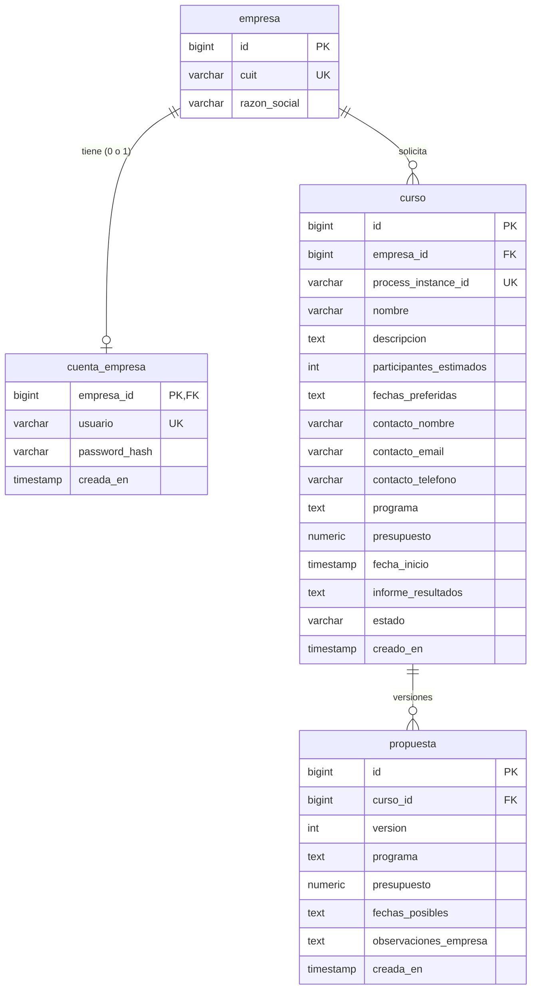

# 07 · Base de datos de la institución

Propuesta de esquema para la BD propia de la institución (§3.2). Es una base aparte de la del motor: se llama
`institucion`, vive en el mismo PostgreSQL del `docker-compose.yml` (la crea `db/init/01-crear-bd-institucion.sql`) y
sus tablas las crea la web con Flyway (`web/src/main/resources/db/migration`).

## 1. Qué guarda y qué no

**Guarda** (§3.2, §4.1.1, §4.1.2, §4.1.3):
- las empresas solicitantes;
- los cursos: nombre (la temática solicitada), descripción, programa, presupuesto, fechas, informe de resultados y estado final;
- el vínculo de cada curso con su instancia de Flowable;
- las cuentas de acceso de las empresas;
- cada versión de la propuesta, para poder regenerar el PDF de cualquiera de ellas.

**No guarda:**
- **El personal de la institución:** entra con su usuario de Flowable (§3.3).
- **Participantes y recursos asignados:** quedan como variables del proceso (§3.2 lo permite).
- **El estado "en curso"** (en preparación, confirmado y pendiente de inicio, en desarrollo, en elaboración del
  informe): se deriva de las actividades activas de la instancia en Flowable. Así no hay dos fuentes que se
  desincronicen. La base solo guarda el **resultado final**.

## 2. Modelo



Decisiones del diseño:
- **La empresa se identifica por CUIT.** Así, cuando vuelve a contratar, *Habilitar acceso* reutiliza su cuenta en
  lugar de crear otra (§4.1.2).
- **El contacto va en el curso, no en la empresa.** Cada solicitud trae su persona de contacto (§4.1.1), y puede
  cambiar de una contratación a otra.
- **La cuenta es una tabla aparte, con 0 o 1 por empresa.** La empresa existe desde la primera solicitud, pero la
  cuenta se crea recién al aceptar una propuesta. Que la cuenta exista o no es exactamente lo que *Habilitar
  acceso* necesita consultar.
- **`propuesta` tiene una fila por versión.** *Revisar propuesta* genera una versión nueva del PDF (§4.1.3); el PDF no
  se guarda, se genera a partir de la fila. `observaciones_empresa` registra el pedido de modificaciones que originó
  la versión siguiente.
- **`curso.programa` y `curso.presupuesto`** guardan lo acordado (la última versión aceptada). El historial queda en
  `propuesta`.
- **`curso.estado`** usa los mismos valores que la variable `resultado` del proceso: `EN_CURSO` mientras la instancia
  está activa, y al terminar `FINALIZADO`, `CANCELADO`, `RECHAZADO`, `SIN_RESPUESTA` o `NO_VIABLE` (§3.4).

## 3. Quién escribe cada dato

| Dato | Lo escribe | Cuándo |
|------|------------|--------|
| `empresa` (si no existe) y `curso` | Web, formulario público | Al enviar la solicitud, antes de iniciar la instancia (§4.1.1) |
| `curso.process_instance_id` | Web | Al iniciar la instancia; el `businessKey` de la instancia es `curso.id` |
| `propuesta` (nueva versión) | Web | Al completar *Registrar y elaborar propuesta* o *Revisar propuesta* |
| `cuenta_empresa` | Motor: `HabilitarAccesoEmpresaDelegate` | En *Habilitar acceso a la empresa*, solo si la empresa no tiene cuenta: genera usuario y clave, y guarda el hash BCrypt |
| `curso.programa`, `curso.presupuesto`, `curso.fecha_inicio`, `curso.informe_resultados`, `curso.estado` | Motor: `RegistrarResultadoDelCursoListener` | Al terminar la instancia, a partir de las variables del proceso |

Las apps de escritorio no escriben en esta base. La app de materiales solo usa la base del motor (§4.2.1).

### Cómo escribe el motor la cuenta

*Habilitar acceso a la empresa* corre dentro del servidor Flowable, que no es una aplicación Spring: el delegate usa
`CuentasDeEmpresaJdbc`, JDBC plano sobre la BD `institucion`, con las credenciales de `INSTITUCION_DB_*` que ya define
`docker-compose.yml` (el driver de PostgreSQL viene en la imagen). El acceso se concentra en una interfaz,
`CuentasDeEmpresa`, para poder probar el delegate con un doble.

- **Consulta:** un join `curso → empresa → cuenta_empresa` por `curso.id` (el `businessKey` de la instancia) devuelve
  la empresa y su usuario, si ya tiene cuenta.
- **Primera contratación:** se genera un usuario a partir de la razón social con el id de la empresa al final
  (`Instituto ABC S.A.`, id 3 → `instituto-abc-s-a-3`, así dos empresas homónimas no chocan) y una clave aleatoria de
  16 caracteres. Se guarda el hash **BCrypt** en `password_hash` y el envío de las credenciales se simula con un log.
- **Segunda contratación:** la cuenta se reutiliza; no se escribe nada y no se reenvían credenciales.
- En los dos casos la variable `accesoHabilitado` queda en `true`, que es lo que cuenta *Cursos en ejecución*.


## 4. Script de creación (propuesta)

```sql
CREATE TABLE empresa (
    id           BIGINT GENERATED ALWAYS AS IDENTITY PRIMARY KEY,
    cuit         VARCHAR(13)  NOT NULL UNIQUE,
    razon_social VARCHAR(200) NOT NULL
);

CREATE TABLE cuenta_empresa (
    empresa_id    BIGINT PRIMARY KEY REFERENCES empresa (id),
    usuario       VARCHAR(100) NOT NULL UNIQUE,
    password_hash VARCHAR(100) NOT NULL, -- BCrypt; la comunicación de la clave se simula (§4.1.2)
    creada_en     TIMESTAMP    NOT NULL DEFAULT now()
);

CREATE TABLE curso (
    id                      BIGINT GENERATED ALWAYS AS IDENTITY PRIMARY KEY,
    empresa_id              BIGINT       NOT NULL REFERENCES empresa (id),
    process_instance_id     VARCHAR(64) UNIQUE,
    nombre                  VARCHAR(200) NOT NULL, -- temática solicitada en el formulario (§4.1.1)
    descripcion             TEXT         NOT NULL,
    participantes_estimados INT          NOT NULL CHECK (participantes_estimados > 0),
    fechas_preferidas       TEXT         NOT NULL,
    contacto_nombre         VARCHAR(200) NOT NULL,
    contacto_email          VARCHAR(200) NOT NULL,
    contacto_telefono       VARCHAR(50),
    programa                TEXT,
    presupuesto             NUMERIC(12, 2),
    fecha_inicio            TIMESTAMP,
    informe_resultados      TEXT,
    estado                  VARCHAR(20)  NOT NULL DEFAULT 'EN_CURSO'
        CHECK (estado IN ('EN_CURSO', 'FINALIZADO', 'CANCELADO', 'RECHAZADO', 'SIN_RESPUESTA', 'NO_VIABLE')),
    creado_en               TIMESTAMP    NOT NULL DEFAULT now()
);

CREATE TABLE propuesta (
    id                    BIGINT GENERATED ALWAYS AS IDENTITY PRIMARY KEY,
    curso_id              BIGINT         NOT NULL REFERENCES curso (id),
    version               INT            NOT NULL CHECK (version > 0),
    programa              TEXT           NOT NULL,
    presupuesto           NUMERIC(12, 2) NOT NULL CHECK (presupuesto >= 0),
    fechas_posibles       TEXT           NOT NULL,
    observaciones_empresa TEXT,
    creada_en             TIMESTAMP      NOT NULL DEFAULT now(),
    UNIQUE (curso_id, version)
);
```

Va como primera migración de Flyway (`V1__esquema_inicial.sql`). Una migración ya pusheada no se edita: los cambios
van en `V2__…`, `V3__…`.

## 5. Datos de prueba

No hacen falta datos fijos: las empresas y los cursos se crean usando el sistema (formulario web + app de
comunicaciones), igual que en la defensa. Si para algún escenario conviene partir de datos cargados (por ejemplo, 5
cursos en ejecución para el escenario de viabilidad), se agrega una migración aparte de datos de prueba.
